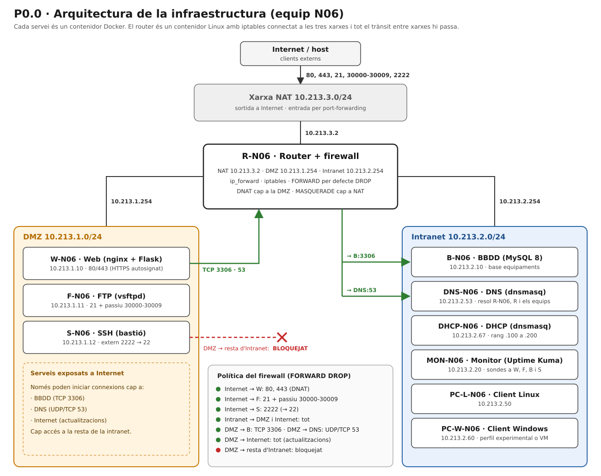

# Arquitectura de la infraestructura

| | |
|---|---|
| **Projecte** | P0.0 · Desplegament d'infraestructura |
| **Mòdul** | 0379 · Projecte intermodular (ASIX) |
| **Equip** | G06 (ASIXc2B) · identificador N06 |
| **Autor** | Josep Pérez |
| **Versió** | 1.0 · 22/10/2026 · Sprint 1 |

## Índex
1. [Objectiu i abast](#1-objectiu-i-abast)
2. [Visió general](#2-visió-general)
3. [Components](#3-components)
4. [Xarxes i segmentació](#4-xarxes-i-segmentació)
5. [Principis de disseny](#5-principis-de-disseny)
6. [Limitacions conegudes](#6-limitacions-conegudes)
7. [Historial de versions](#7-historial-de-versions)

## 1. Objectiu i abast
Aquest document descriu l'arquitectura de la infraestructura multicapa de la pràctica P0.0: quins components hi ha, com es connecten i per què s'han dissenyat així. Cada servei s'executa en un **contenidor Docker** en lloc d'una màquina virtual per servei. La justificació tecnològica és a l'[estudi previ](09-estudi-previ.md).

## 2. Visió general
El router és un contenidor Linux amb `ip_forward` i `iptables`, connectat a tres xarxes (DMZ, Intranet i NAT). Tot el trànsit entre xarxes passa pel router.

*Figura 1. Arquitectura de la infraestructura (equip N06).*

## 3. Components
| Component | Nom | Tecnologia | Xarxa |
|---|---|---|---|
| Router i firewall | R-N06 | Linux, `iptables` | NAT, DMZ i Intranet |
| Web | W-N06 | nginx i Flask | DMZ |
| FTP | F-N06 | vsftpd | DMZ |
| SSH (bastió) | S-N06 | OpenSSH | DMZ |
| Base de dades | B-N06 | MySQL 8 | Intranet |
| DNS | DNS-N06 | dnsmasq | Intranet |
| DHCP | DHCP-N06 | dnsmasq | Intranet |
| Monitor de xarxa | MON-N06 | Uptime Kuma | Intranet |
| Client Linux | PC-L-N06 | Ubuntu | Intranet |
| Client Windows | PC-W-N06 | Windows (màquina virtual) | Intranet |

## 4. Xarxes i segmentació
| Xarxa | Subxarxa | Funció |
|---|---|---|
| NAT | 10.213.3.0/24 | Sortida a Internet i entrada pel port-forwarding del router |
| DMZ | 10.213.1.0/24 | Serveis exposats a Internet (web, FTP i SSH) |
| Intranet | 10.213.2.0/24 | Serveis interns (BBDD, DNS, DHCP, monitor i clients) |

## 5. Principis de disseny
- **Segmentació:** els serveis exposats viuen a la DMZ i només poden iniciar connexions cap a la BBDD i el DNS.
- **Punt únic de control:** tots els contenidors tenen el router com a *gateway*, de manera que el firewall veu tot el trànsit entre xarxes.
- **Reproductibilitat:** la infraestructura es descriu amb fitxers del repositori i es desplega amb una sola comanda.
- **Mínim privilegi:** el firewall segueix la política `FORWARD DROP` i només s'obre el que cal.

## 6. Limitacions conegudes
- Els contenidors comparteixen el nucli del sistema amfitrió, de manera que l'aïllament és més feble que amb màquines virtuals.
- El client Windows no pot ser un contenidor Linux i s'executa com a màquina virtual.

## 7. Historial de versions
| Versió | Data | Canvis |
|---|---|---|
| 1.0 | 22/10/2026 | Primera versió: components, xarxes i diagrama |
