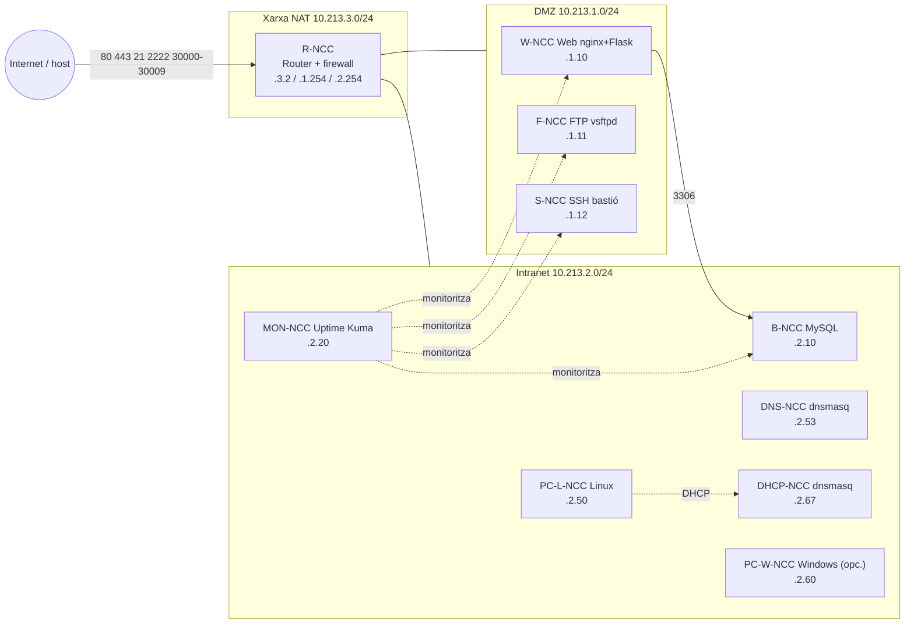

# 1. Arquitectura

Aplicació multicapa (Web - Monitor - SSH - BBDD - DHCP - DNS - FTP) desplegada com a **contenidors Docker**
en lloc d'una màquina virtual per servei. El router és un contenidor Linux amb `ip_forward` i `iptables`
connectat a tres xarxes Docker (DMZ, Intranet i NAT).

## Adreçament

| Equip | Hostname | Xarxa | IP |
|---|---|---|---|
| Router | R-NCC (alias `R`) | NAT / DMZ / Intranet | 10.213.3.2 / 10.213.1.254 / 10.213.2.254 |
| Web | W-NCC | DMZ | 10.213.1.10 |
| FTP | F-NCC | DMZ | 10.213.1.11 |
| SSH | S-NCC | DMZ | 10.213.1.12 |
| BBDD | B-NCC | Intranet | 10.213.2.10 |
| DNS | DNS-NCC | Intranet | 10.213.2.53 |
| DHCP | DHCP-NCC (rang .100-.200) | Intranet | 10.213.2.67 |
| Monitor | MON-NCC | Intranet | 10.213.2.20 |
| PC Linux | PC-L-NCC | Intranet | 10.213.2.50 |
| PC Windows | PC-W-NCC (opcional) | Intranet | 10.213.2.60 |

## Flux de trànsit i política del firewall (router)

Política `FORWARD DROP` i només s'obre el necessari:

| Origen → Destí | Permès |
|---|---|
| Intranet → DMZ / Internet | tot |
| DMZ → BBDD | TCP 3306 |
| DMZ → DNS | UDP/TCP 53 |
| DMZ → Internet | tot (actualitzacions) |
| Internet → W | 80, 443 |
| Internet → F | 21 i passiu 30000-30009 |
| Internet → S | 2222 (→ 22) |
| DMZ → resta d'Intranet | **bloquejat** |

Tots els contenidors tenen el router com a gateway (`ip route replace default via ...` a l'entrypoint),
de manera que el trànsit entre xarxes sempre passa pel firewall.
