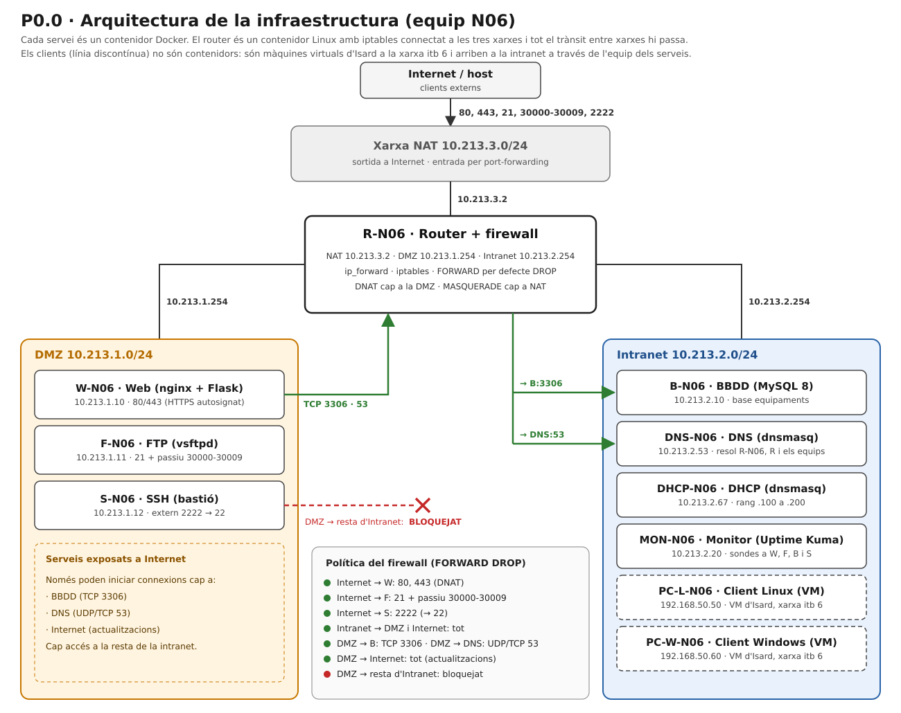

# Arquitectura de la infraestructura

| | |
|---|---|
| **Projecte** | P0.0 · Desplegament d'infraestructura |
| **Mòdul** | 0379 · Projecte intermodular (ASIX) |
| **Equip** | G06 (ASIXc2B) · identificador N06 |
| **Autors** | Josep Pérez, Hèctor Martí |
| **Versió** | 1.5 · 23/11/2026 · Sprint 2 |

## Índex
1. [Objectiu i abast](#1-objectiu-i-abast)
2. [Visió general](#2-visió-general)
3. [Components](#3-components)
4. [Xarxes i segmentació](#4-xarxes-i-segmentació)
5. [Adreçament IP](#5-adreçament-ip)
6. [Política del firewall](#6-política-del-firewall)
7. [Principis de disseny](#7-principis-de-disseny)
8. [Limitacions conegudes](#8-limitacions-conegudes)
9. [Resolució de problemes del router](#9-resolució-de-problemes-del-router)
10. [Historial de versions](#10-historial-de-versions)

## 1. Objectiu i abast
Aquest document descriu l'arquitectura de la infraestructura multicapa de la pràctica P0.0: quins components hi ha, com es connecten i per què s'han dissenyat així. Cada servei s'executa en un **contenidor Docker** en lloc d'una màquina virtual per servei. Els dos clients (Linux i Windows) són l'excepció: són màquines virtuals al laboratori d'Isard. La justificació tecnològica és a l'[estudi previ](09-estudi-previ.md).

## 2. Visió general
El router és un contenidor Linux amb `ip_forward` i `iptables`, connectat a tres xarxes (DMZ, Intranet i NAT). Tot el trànsit entre xarxes passa pel router.



*Figura 1. Arquitectura de la infraestructura (equip N06).*

## 3. Components
| Component | Nom | Tecnologia | Xarxa |
|---|---|---|---|
| Router i firewall | R-N06 | Linux, `iptables` | NAT, DMZ i Intranet |
| Web | W-N06 | nginx i Flask | DMZ |
| FTP | F-N06 | vsftpd | DMZ |
| SSH (bastió) | S-N06 | OpenSSH | DMZ |
| Base de dades | B-N06 | MySQL 8 | Intranet |
| DNS | DNS-N06 | dnsmasq | Intranet |
| DHCP | DHCP-N06 | dnsmasq | Intranet |
| Monitor de xarxa | MON-N06 | Uptime Kuma | Intranet |
| Client Linux | PC-L-N06 | Ubuntu (màquina virtual a Isard) | itb 6 |
| Client Windows | PC-W-N06 | Windows (màquina virtual a Isard) | itb 6 |

## 4. Xarxes i segmentació
| Xarxa | Subxarxa | Funció |
|---|---|---|
| NAT | 10.213.3.0/24 | Sortida a Internet i entrada pel port-forwarding del router |
| DMZ | 10.213.1.0/24 | Serveis exposats a Internet (web, FTP i SSH) |
| Intranet | 10.213.2.0/24 | Serveis interns (BBDD, DNS, DHCP i monitor) |
| itb 6 | 192.168.50.0/24 | Xarxa del laboratori d'Isard on són els clients i l'equip dels serveis |

### 4.1 Connexió dels clients (itb 6)
Els clients no són contenidors: són dues màquines virtuals al laboratori d'Isard, cadascuna amb una targeta a la xarxa `itb 6` (192.168.50.0/24). L'equip on s'executa Docker també hi té una targeta (`enp3s0`, 192.168.50.22) i fa de *gateway* entre `itb 6` i la intranet:

- Els clients tenen una ruta `10.213.2.0/24 via 192.168.50.22`.
- L'equip dels serveis reenvia el trànsit entre `enp3s0` i el pont de la intranet (`br-intranet`) amb el script `scripts/xarxa-clients.sh`.
- Les respostes tornen pel router (`R-N06`), que té una ruta `192.168.50.0/24 via 10.213.2.1` (l'equip dels serveis a la intranet).
- Els clients només tenen la targeta d'`itb 6`: surten a Internet a través de l'equip dels serveis, amb NAT (`scripts/xarxa-clients.sh --internet`), i no pel router de la pràctica.

Es va provar abans de connectar la targeta d'`itb 6` directament a la intranet (amb un pont i amb `ipvlan`), però no funciona: un pont fa que els contenidors surtin amb la seva pròpia MAC, que la xarxa virtual d'Isard descarta, i amb `ipvlan` el trànsit que ha de passar pel router surt per la targeta en comptes d'arribar al router (la web no hauria pogut arribar a la BBDD). Amb el reenviament per IP, la intranet continua sent un pont normal i tot el trànsit entre xarxes passa pel router.

Docker 28 o superior bloqueja per defecte l'accés directe des de fora a les IP dels contenidors; per això la xarxa `intranet` usa el mode de pasarel·la `nat-unprotected` (només aquesta xarxa). El procediment complet és al [document dels clients](04-clients-isard.md).

## 5. Adreçament IP
Totes les adreces són fixes i es defineixen a `docker-compose.yml`. En cada xarxa, l'adreça `.1` la reserva Docker com a *gateway* intern i no l'usa cap equip de la pràctica.

| Equip | Hostname | Xarxa | Adreça IP |
|---|---|---|---|
| Router | R-N06 (àlies `R`) | NAT / DMZ / Intranet | 10.213.3.2 / 10.213.1.254 / 10.213.2.254 |
| Web | W-N06 | DMZ | 10.213.1.10 |
| FTP | F-N06 | DMZ | 10.213.1.11 |
| SSH (bastió) | S-N06 | DMZ | 10.213.1.12 |
| Base de dades | B-N06 | Intranet | 10.213.2.10 |
| Monitor de xarxa | MON-N06 | Intranet | 10.213.2.20 |
| DNS | DNS-N06 | Intranet | 10.213.2.53 |
| Client Linux | PC-L-N06 | itb 6 | 192.168.50.50 (ruta cap a la intranet per 192.168.50.22) |
| Client Windows | PC-W-N06 | itb 6 | 192.168.50.60 (ruta cap a la intranet per 192.168.50.22) |
| DHCP | DHCP-N06 | Intranet | 10.213.2.67 (reparteix el rang 10.213.2.100 a 10.213.2.200) |

El *gateway* per defecte dels equips de la DMZ és `10.213.1.254` i el dels equips de la intranet és `10.213.2.254`, de manera que tot el trànsit entre xarxes passa pel router.

## 6. Política del firewall
El router aplica la política `FORWARD DROP`: tot el trànsit que ha de travessar el router queda bloquejat, excepte el que es permet explícitament. El trànsit que entra o surt del propi router (`INPUT` i `OUTPUT`) no es filtra.

### 6.1 Regles permeses
| # | Origen | Destí | Protocol i port | Motiu |
|---|---|---|---|---|
| 1 | Qualsevol | Qualsevol | Respostes de connexions ja establertes | Permet que tornin les respostes |
| 2 | Intranet | DMZ i Internet | Tot | La intranet és de confiança |
| 3 | DMZ | BBDD (B-N06) | TCP 3306 | La web consulta la base de dades |
| 4 | DMZ | DNS (DNS-N06) | UDP i TCP 53 | Resolució de noms |
| 5 | DMZ | Internet | Tot | Actualitzacions |
| 6 | Internet | Web (W-N06) | TCP 80 i 443 | Servei públic |
| 7 | Internet | FTP (F-N06) | TCP 21 i 30000-30009 | FTP actiu i mode passiu |
| 8 | Internet | SSH (S-N06) | TCP 2222 | Accés d'administració pel bastió (vegeu el [document 07](07-servidor-ssh.md)) |

Tot el que no coincideix amb cap d'aquestes regles es bloqueja. Els paquets descartats es registren (límit de 5 per minut) amb el prefix `FW-DROP:`.

### 6.2 Trànsit bloquejat
| Origen | Destí | Resultat |
|---|---|---|
| DMZ | Resta de la intranet (excepte BBDD per 3306 i DNS per 53) | Bloquejat |
| Internet | Intranet | Bloquejat |
| Internet | Serveis de la DMZ per ports no publicats | Bloquejat |

Així, si un servei exposat a Internet es veiés compromès, no podria arribar a la resta de la xarxa interna.

### 6.3 Reenviament de ports (NAT)
| Port d'entrada (host) | Destí | Port destí |
|---|---|---|
| 80 i 443 | W-N06 (10.213.1.10) | 80 i 443 |
| 21 i 30000-30009 | F-N06 (10.213.1.11) | 21 i 30000-30009 |
| 2222 | S-N06 (10.213.1.12) | 2222 |

La sortida a Internet dels equips interns es fa amb emmascarament (`MASQUERADE`) a la interfície de la xarxa NAT.

### 6.4 Implementació del router
El router `R-N06` és un contenidor Linux creat amb la imatge base i connectat a les tres xarxes. Fa tres feines: reenvia el trànsit (`net.ipv4.ip_forward=1`, definit a `docker-compose.yml`), fa NAT (`MASQUERADE` a la interfície de la xarxa NAT) i filtra amb `iptables` (política `FORWARD DROP`). És el *gateway* de tots els equips de la DMZ i de la intranet.

El nom de la interfície (`eth0`, `eth1`...) no és fix: el script la detecta pel prefix de l'adreça IP de cada xarxa.

| Fitxer | Contingut |
|---|---|
| `services/router/init.sh` | Ruta per defecte, política, regles de `iptables`, reenviament de ports i NAT |
| `docker-compose.yml` | Servei `router`: `sysctls`, volum de `init.sh`, comprovació de salut i les tres xarxes |

L'entrypoint de la imatge base executa `/opt/init.sh` en arrencar el contenidor. El `healthcheck` comprova que la regla `MASQUERADE` està aplicada, i la resta de serveis no arrenquen fins que el router és `healthy`.

### 6.5 Validació del router
Validació del disseny, sense desplegar:

```bash
bash -n services/router/init.sh
docker compose config --quiet && echo "compose OK"
docker compose build router
```

Resultat esperat: l'script no té errors de sintaxi, el `docker-compose.yml` és correcte i la imatge es construeix. L'estat `healthy` del router només es pot comprovar amb els contenidors en marxa (`docker compose ps`). Els resultats de les proves de xarxa i de seguretat del router són al [pla de proves](15-criteris-rendiment-disponibilitat.md#7-pla-de-proves).

## 7. Principis de disseny
- **Segmentació:** els serveis exposats viuen a la DMZ i només poden iniciar connexions cap a la BBDD i el DNS.
- **Punt únic de control:** tots els contenidors tenen el router com a *gateway*, de manera que el firewall veu tot el trànsit entre xarxes.
- **Reproductibilitat:** la infraestructura es descriu amb fitxers del repositori i es desplega amb una sola comanda.
- **Mínim privilegi:** el firewall segueix la política `FORWARD DROP` i només s'obre el que cal.

## 8. Limitacions conegudes
- Els contenidors comparteixen el nucli del sistema amfitrió, de manera que l'aïllament és més feble que amb màquines virtuals.
- El client Windows no pot ser un contenidor Linux i s'executa com a màquina virtual.
- Els clients no estan a la intranet sinó a `itb 6`: arriben als serveis a través de l'equip dels serveis, i el DHCP de la intranet no els pot repartir adreces (la difusió no travessa l'enrutament).
- Les regles de reenviament de l'equip dels serveis (`scripts/xarxa-clients.sh`) no sobreviuen a un reinici: cal tornar a executar el script després de `docker compose up`.
- Les adreces 192.168.50.x són les del laboratori d'Isard; en un altre entorn cal canviar-les al script, al router i als clients.

## 9. Resolució de problemes del router
| Símptoma | Causa probable | Solució |
|---|---|---|
| El client de la intranet no surt a Internet | El router no ha acabat d'arrencar o no té `ip_forward` | `docker compose ps` (ha d'estar `healthy`) i `docker exec R-N06 sysctl net.ipv4.ip_forward` |
| El router no passa a `healthy` | Les regles d'`init.sh` han fallat | `docker logs R-N06` |
| Cap equip arriba a Internet | La ruta per defecte del router no és correcta | `docker exec R-N06 ip route` (ha de passar per `10.213.3.1`) |
| Un paquet es bloqueja i no se sap per què | La política és `FORWARD DROP` | `docker logs R-N06` o `dmesg` mostren les entrades `FW-DROP:` |
| Un port publicat no arriba al servei de la DMZ | Docker el publica per la pota de la DMZ en comptes de la de NAT | Comprovar `gw_priority: 1` a la xarxa `nat` i recrear el router (vegeu el [document 07](07-servidor-ssh.md), apartat 7) |

## 10. Historial de versions
| Versió | Data | Canvis |
|---|---|---|
| 1.0 | 22/10/2026 | Primera versió: components, xarxes i diagrama |
| 1.1 | 26/10/2026 | Adreçament IP i política del firewall (Hèctor Martí) |
| 1.2 | 17/11/2026 | Els clients passen a ser màquines virtuals a Isard connectades per itb 6 |
| 1.3 | 18/11/2026 | Els clients arriben a la intranet per enrutament a través de l'equip dels serveis (en lloc d'`ipvlan`) |
| 1.4 | 22/11/2026 | El servidor SSH escolta al port 2222 (no al 22) i el router hi fa el reenviament |
| 1.5 | 23/11/2026 | S'hi integra el document del router i el firewall (abans el document 10, d'Hèctor Martí): implementació, validació i resolució de problemes |
