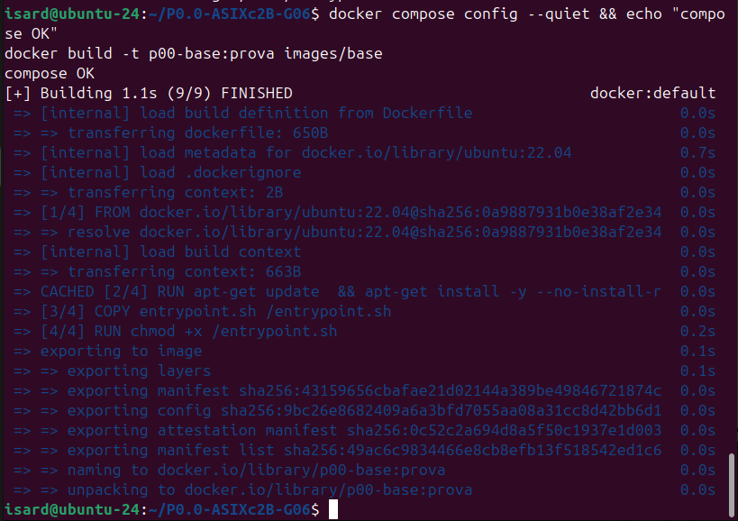

# Manual de desplegament (client)

| | |
|---|---|
| **Projecte** | P0.0 · Desplegament d'infraestructura |
| **Mòdul** | 0379 · Projecte intermodular (ASIX) |
| **Equip** | G06 (ASIXc2B) · identificador N06 |
| **Autor** | Josep Pérez |
| **Versió** | 1.0 · 22/10/2026 · Sprint 1 |

## Índex
1. [Objectiu i abast](#1-objectiu-i-abast)
2. [Requisits](#2-requisits)
3. [Preparació de Docker](#3-preparació-de-docker)
4. [Obtenció del projecte](#4-obtenció-del-projecte)
5. [Imatge base](#5-imatge-base)
6. [Xarxes](#6-xarxes)
7. [Comprovació](#7-comprovació)
8. [Resolució de problemes](#8-resolució-de-problemes)
9. [Historial de versions](#9-historial-de-versions)

## 1. Objectiu i abast
Aquest manual explica com preparar l'entorn i validar la base de la infraestructura: la **imatge base** comuna i les **tres xarxes** (DMZ, Intranet i NAT). Els serveis (BBDD, DNS, web, FTP...) s'hi afegeixen en els sprints següents i aquest manual s'amplia amb ells.

## 2. Requisits
- Linux (provat a Ubuntu 24) amb **Docker Engine 24 o superior** i **Docker Compose v2**.
- **Git**, per descarregar el projecte.
- Accés a Internet, per baixar la imatge `ubuntu:22.04` i els paquets.

## 3. Preparació de Docker
Si Docker no està instal·lat, es fa amb el repositori oficial:

```bash
sudo apt-get update && sudo apt-get install -y ca-certificates curl
sudo install -m 0755 -d /etc/apt/keyrings
sudo curl -fsSL https://download.docker.com/linux/ubuntu/gpg -o /etc/apt/keyrings/docker.asc
echo "deb [arch=$(dpkg --print-architecture) signed-by=/etc/apt/keyrings/docker.asc] https://download.docker.com/linux/ubuntu $(. /etc/os-release && echo "${UBUNTU_CODENAME:-$VERSION_CODENAME}") stable" | sudo tee /etc/apt/sources.list.d/docker.list
sudo apt-get update
sudo apt-get install -y docker-ce docker-ce-cli containerd.io docker-buildx-plugin docker-compose-plugin
sudo usermod -aG docker $USER
```

Cal tancar i tornar a obrir la sessió perquè el grup `docker` s'apliqui. Comprovació:

```bash
docker --version
docker compose version
```

## 4. Obtenció del projecte
```bash
git clone git@github.com:hectormarti7e7/P0.0-ASIXc2B-G06.git
cd P0.0-ASIXc2B-G06
cp .env.example .env
```

El fitxer `.env` conté l'identificador de l'equip (`NCC=N06`), que dona nom als contenidors (`R-N06`, `PC-L-N06`...). El fitxer `.env` no es puja al repositori; `.env.example` sí.

## 5. Imatge base
Tots els equips es construeixen a partir d'**una sola imatge** (`images/base/Dockerfile`), basada en Ubuntu 22.04. Inclou:

| Component | Paquets o configuració |
|---|---|
| Accés remot | `openssh-server` |
| Eines de xarxa | `iproute2`, `iptables`, `iputils-ping`, `dnsutils`, `net-tools`, `curl` |
| Utilitats | `sudo`, `nano`, `procps`, `gettext-base`, `ca-certificates` |
| Usuari de la pràctica | `bchecker` / `bchecker121`, amb permís de `sudo` |

El que canvia entre serveis és l'argument de construcció `PKGS`, que afegeix els paquets propis de cada servei.

En arrencar, `images/base/entrypoint.sh` fa, per aquest ordre:
1. Si hi ha la variable `GATEWAY`, fixa la ruta per defecte pel router de la pràctica, en lloc del gateway de Docker.
2. Si hi ha la variable `DNS_SERVER`, configura el DNS.
3. Si existeix `/opt/init.sh`, executa la configuració pròpia del servei.
4. Arrenca `sshd` i, finalment, el procés principal del contenidor.

## 6. Xarxes
`docker-compose.yml` defineix tres xarxes *bridge* amb adreçament fix:

| Xarxa | Subxarxa | Contingut |
|---|---|---|
| `dmz` | 10.213.1.0/24 | Serveis exposats a Internet |
| `intranet` | 10.213.2.0/24 | Serveis interns i clients |
| `nat` | 10.213.3.0/24 | Sortida a Internet |

El router (`R-N06`) és l'únic contenidor connectat a les tres xarxes (10.213.3.2, 10.213.1.254 i 10.213.2.254). La resta tenen el router com a *gateway*. En aquest punt del projecte, el compose inclou el router i un client Linux (`PC-L-N06`, 10.213.2.50) sobre la imatge base.

S'ha triat el rang 10.213.0.0/16 perquè el 172.20.0.0/16 xocava amb una xarxa Docker ja existent al servidor.

## 7. Comprovació
En aquesta fase es valida el disseny sense desplegar serveis:

```bash
docker compose config --quiet && echo "compose OK"
docker build -t p00-base:prova images/base
```

Resultat esperat: el missatge `compose OK` i la imatge `p00-base:prova` construïda sense errors.



*Figura 1. Validació del compose i construcció de la imatge base (22/10/2026).*

## 8. Resolució de problemes
| Símptoma | Causa probable | Solució |
|---|---|---|
| `Pool overlaps with other one on this address space` | Una xarxa Docker existent usa el mateix rang | Triar un rang lliure i canviar-lo a les tres subxarxes del `docker-compose.yml` |
| `permission denied` en executar `docker` | L'usuari no és al grup `docker` | `sudo usermod -aG docker $USER` i tornar a iniciar la sessió |
| Falla `apt-get` en construir la imatge | No hi ha accés a Internet | Comprovar la connexió i tornar a executar `docker build` |
| `docker compose config` mostra un error de format | El fitxer YAML té una indentació incorrecta | Revisar la línia que indica l'error |

## 9. Historial de versions
| Versió | Data | Canvis |
|---|---|---|
| 1.0 | 22/10/2026 | Primera versió: requisits, imatge base, xarxes i comprovació |
