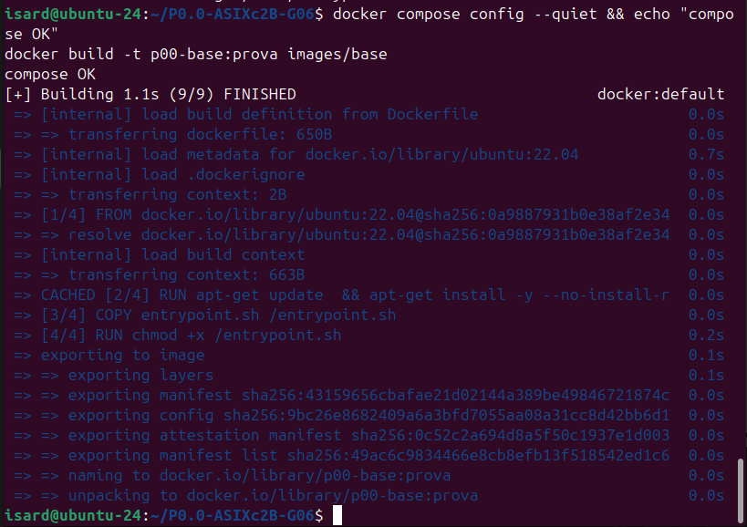

# Manual d'instal·lació i administració

| | |
|---|---|
| **Projecte** | P0.0 · Desplegament d'infraestructura |
| **Mòdul** | 0379 · Projecte intermodular (ASIX) |
| **Equip** | G06 (ASIXc2B) · identificador N06 |
| **Autor** | Josep Pérez |
| **Versió** | 2.0 · 23/11/2026 · Sprint 2 |

## Índex
1. [Objectiu i abast](#1-objectiu-i-abast)
2. [Requisits](#2-requisits)
3. [Preparació de Docker](#3-preparació-de-docker)
4. [Obtenció del projecte](#4-obtenció-del-projecte)
5. [Imatge base](#5-imatge-base)
6. [Xarxes](#6-xarxes)
7. [Serveis i dependències](#7-serveis-i-dependències)
8. [Desplegament complet](#8-desplegament-complet)
9. [Configuració i secrets](#9-configuració-i-secrets)
10. [Operació](#10-operació)
11. [Manteniment](#11-manteniment)
12. [Comprovació](#12-comprovació)
13. [Resolució de problemes](#13-resolució-de-problemes)
14. [Limitacions conegudes](#14-limitacions-conegudes)
15. [Historial de versions](#15-historial-de-versions)

## 1. Objectiu i abast
Aquest manual explica com instal·lar, operar i mantenir tota la infraestructura: la **imatge base**, les **tres xarxes** (DMZ, Intranet i NAT) i els **serveis** (router, BBDD, web, FTP, SSH, DNS, DHCP i monitor). Substitueix els manuals separats del sprint 1 i del sprint 2. El detall de cada servei és als documents que s'hi enllacen.

## 2. Requisits
- Linux (provat a Ubuntu 24) amb **Docker Engine 24 o superior** i **Docker Compose v2**.
- **Git**, per descarregar el projecte.
- Accés a Internet, per baixar la imatge `ubuntu:22.04` i els paquets.
- Una targeta de l'equip connectada a la xarxa `itb 6` d'Isard (`enp3s0` a l'equip de proves), per on arriben els clients (vegeu el [document dels clients](04-clients-isard.md)).

## 3. Preparació de Docker
Si Docker no està instal·lat, es fa amb el repositori oficial:

```bash
sudo apt-get update && sudo apt-get install -y ca-certificates curl
sudo install -m 0755 -d /etc/apt/keyrings
sudo curl -fsSL https://download.docker.com/linux/ubuntu/gpg -o /etc/apt/keyrings/docker.asc
echo "deb [arch=$(dpkg --print-architecture) signed-by=/etc/apt/keyrings/docker.asc] https://download.docker.com/linux/ubuntu $(. /etc/os-release && echo "${UBUNTU_CODENAME:-$VERSION_CODENAME}") stable" | sudo tee /etc/apt/sources.list.d/docker.list
sudo apt-get update
sudo apt-get install -y docker-ce docker-ce-cli containerd.io docker-buildx-plugin docker-compose-plugin
sudo usermod -aG docker $USER
```

Cal tancar i tornar a obrir la sessió perquè el grup `docker` s'apliqui. Comprovació:

```bash
docker --version
docker compose version
```

## 4. Obtenció del projecte
```bash
git clone git@github.com:hectormarti7e7/P0.0-ASIXc2B-G06.git
cd P0.0-ASIXc2B-G06
cp .env.example .env
```

El fitxer `.env` conté l'identificador de l'equip (`NCC=N06`), que dona nom als contenidors (`R-N06`, `B-N06`...). El fitxer `.env` no es puja al repositori; `.env.example` sí.

## 5. Imatge base
Tots els equips es construeixen a partir d'**una sola imatge** (`images/base/Dockerfile`), basada en Ubuntu 22.04. Inclou:

| Component | Paquets o configuració |
|---|---|
| Accés remot | `openssh-server` |
| Eines de xarxa | `iproute2`, `iptables`, `iputils-ping`, `dnsutils`, `net-tools`, `curl` |
| Utilitats | `sudo`, `nano`, `procps`, `gettext-base`, `ca-certificates` |
| Usuari de la pràctica | `bchecker` / `bchecker121`, amb permís de `sudo` |

El que canvia entre serveis és l'argument de construcció `PKGS`, que afegeix els paquets propis de cada servei.

En arrencar, `images/base/entrypoint.sh` fa, per aquest ordre:
1. Si hi ha la variable `GATEWAY`, fixa la ruta per defecte pel router de la pràctica, en lloc del gateway de Docker.
2. Si hi ha la variable `DNS_SERVER`, configura el DNS.
3. Si existeix `/opt/init.sh`, executa la configuració pròpia del servei.
4. Arrenca `sshd` i, finalment, el procés principal del contenidor.

## 6. Xarxes
`docker-compose.yml` defineix tres xarxes amb adreçament fix (tres ponts *bridge*; la `intranet` té el nom fix `br-intranet` i el mode `nat-unprotected` perquè els clients d'Isard hi arribin, vegeu l'[arquitectura](01-arquitectura.md), apartat 4.1):

| Xarxa | Subxarxa | Contingut |
|---|---|---|
| `dmz` | 10.213.1.0/24 | Serveis exposats a Internet |
| `intranet` | 10.213.2.0/24 | Serveis interns i clients |
| `nat` | 10.213.3.0/24 | Sortida a Internet |

El router (`R-N06`) és l'únic contenidor connectat a les tres xarxes (10.213.3.2, 10.213.1.254 i 10.213.2.254). La resta tenen el router com a *gateway*. Els clients no són al compose: són màquines virtuals a Isard (vegeu el [document dels clients](04-clients-isard.md)).

Per connectar els clients d'Isard, després d'aixecar els contenidors s'executa a l'equip dels serveis:

```bash
sudo ./scripts/xarxa-clients.sh
```

S'ha triat el rang 10.213.0.0/16 perquè el 172.20.0.0/16 xocava amb una xarxa Docker ja existent al servidor.

## 7. Serveis i dependències

| Contenidor | IP | Servei | Document |
|---|---|---|---|
| `R-N06` | 10.213.3.2, 10.213.1.254, 10.213.2.254 | Router i *firewall* | [10](10-router-firewall.md) |
| `W-N06` | 10.213.1.10 | nginx (80, 443) + Flask | [06](06-aplicacio-web.md) |
| `F-N06` | 10.213.1.11 | FTP (vsftpd, 21 i 30000-30009) | [24](24-servidor-ftp.md) |
| `S-N06` | 10.213.1.12 | SSH (port 2222) | [07](07-servidor-ssh.md) |
| `B-N06` | 10.213.2.10 | MySQL (base `equipaments`) | [03](03-bbdd-mysql.md), [05](05-carrega-csv.md) |
| `MON-N06` | 10.213.2.20 | Uptime Kuma (port 3001) | [26](26-monitoritzacio.md) |
| `DNS-N06` | 10.213.2.53 | dnsmasq (domini `asix.local`) | [08](08-servidor-dns.md) |
| `DHCP-N06` | 10.213.2.67 | dnsmasq (rang 10.213.2.100-200) | [25](25-servidor-dhcp.md) |

Ports publicats pel router a l'host: 2222, 80, 443, 21 i 30000-30009.

Dependències:
- Tots els serveis esperen que el router estigui sa (`healthcheck`).
- `W-N06` espera que `B-N06` estigui sa; si la BBDD cau, la web no serveix dades.
- Els contenidors fan servir el DNS `10.213.2.53` (excepte el propi DNS).
- Tots els contenidors tenen l'usuari `bchecker`.

## 8. Desplegament complet
```bash
sudo ./scripts/xarxa-clients.sh          # regles per als clients d'Isard
docker compose config --quiet            # valida el compose
docker compose up -d --build --wait      # construeix i arrenca
docker exec B-N06 python3 /opt/load_csv.py   # càrrega de les dades
```

La càrrega del CSV, la variant sense descàrrega (`data/equipaments.csv`) i les consultes de verificació són al [document 05](05-carrega-csv.md).

## 9. Configuració i secrets
- `.env`: identificador de l'equip (`NCC`) i `FTP_PASV_ADDRESS` (per defecte 192.168.50.22).
- Les credencials `bchecker` / `bchecker121` les exigeix l'enunciat i són al `docker-compose.yml` (`DB_PASS`, `APP_PASS`). Canviar-les implica editar el compose i recrear els serveis afectats.
- SSH només accepta clau pública: la clau de l'usuari és a `services/ssh/authorized_keys`.

## 10. Operació
| Tasca | Ordre |
|---|---|
| Estat dels serveis | `docker compose ps` |
| Registres d'un servei | `docker compose logs --tail 50 <servei>` |
| Aturar tot | `docker compose down` (conserva el volum de la BBDD) |
| Arrencar tot | `docker compose up -d` |
| Aplicar un canvi en un fitxer muntat | `docker compose up -d --force-recreate <servei>` |
| Reconstruir una imatge | `docker compose up -d --build <servei>` |
| Entrar en un contenidor | `docker exec -it <nom> bash` |
| Estat de les sondes | `estat_sondes.py` ([document 26](26-monitoritzacio.md)) |

Noms dels serveis al compose: `router`, `ssh`, `web`, `ftp`, `monitor`, `dhcp`, `dns`, `db`.

> `docker compose down -v` esborra els volums (dades de MySQL i del monitor). No s'ha d'usar si no es vol perdre la BBDD.

## 11. Manteniment
- **Còpia de la BBDD**: `mysqldump`, com al [document 05](05-carrega-csv.md). No s'ha provat la restauració.
- **Tornar a carregar el CSV**: el *loader* fa `DROP TABLE IF EXISTS`; cal fer abans una còpia.
- **Reinici de l'host**: les regles de `DOCKER-USER` no persisteixen. Cal tornar a executar `sudo ./scripts/xarxa-clients.sh` (amb `--internet` si els clients han de sortir a Internet).
- **Actualitzacions**: reconstruir amb `--build`. La imatge d'Uptime Kuma és Debian 10 i usa `archive.debian.org`.
- **Fitxers muntats**: si l'origen no existeix, Docker crea un directori amb aquest nom; s'elimina amb `sudo rmdir <ruta>`.

## 12. Comprovació
Validació del disseny, sense desplegar serveis:

```bash
docker compose config --quiet && echo "compose OK"
docker build -t p00-base:prova images/base
```

Resultat esperat: el missatge `compose OK` i la imatge `p00-base:prova` construïda sense errors.



*Figura 1. Validació del compose i construcció de la imatge base (22/10/2026).*

Comprovació dels serveis desplegats:

```bash
docker compose ps
./scripts/comprova.sh
```

`scripts/comprova.sh` mostra `PASS` o `FAIL` per a cada prova. El pla de proves complet és al [document 20](20-pla-proves.md).

## 13. Resolució de problemes
| Símptoma | Causa probable | Solució |
|---|---|---|
| `Pool overlaps with other one on this address space` | Una xarxa Docker existent usa el mateix rang | Triar un rang lliure i canviar-lo a les tres subxarxes del `docker-compose.yml` |
| `permission denied` en executar `docker` | L'usuari no és al grup `docker` | `sudo usermod -aG docker $USER` i tornar a iniciar la sessió |
| Falla `apt-get` en construir la imatge | No hi ha accés a Internet | Comprovar la connexió i tornar a executar `docker build` |
| `docker compose config` mostra un error de format | El fitxer YAML té una indentació incorrecta | Revisar la línia que indica l'error |
| Els clients d'Isard no arriben als contenidors | Falten les regles de reenviament o el mode de la xarxa | Vegeu el [document dels clients](04-clients-isard.md), apartat 7 |
| SSH «Connection refused» des del client | El port publicat entra per la DMZ | Comprovar `gw_priority: 1` a la xarxa `nat` i recrear el router |
| Un servei no arrenca i hi ha un directori on hauria d'haver un fitxer | *Bind mount* amb origen inexistent | `sudo rmdir` i recrear el servei |
| El canvi en un fitxer de configuració no s'aplica | El contenidor no es reinicia | `--force-recreate <servei>` |
| Els clients no arriben a la intranet després d'un reinici | Regles `iptables` perdudes | `sudo ./scripts/xarxa-clients.sh` |
| La web no mostra dades | `B-N06` caigut | `docker start B-N06` i mirar el tauler |
| `dig` no resol des de `DNS-N06` | S'usa el DNS de Docker (127.0.0.11) | `dig @127.0.0.1 <nom>` |
| Caràcters estranys a les consultes | Codificació del client | `--default-character-set=utf8mb4` |
| El client Linux no rep DHCP | La difusió no travessa `itb 6` | Limitació; vegeu el [document 25](25-servidor-dhcp.md) |

## 14. Limitacions conegudes
FTP sense TLS, DHCP que no arriba als clients de `itb 6`, regles de l'host no persistents, certificats autosignats, sense notificacions al monitor i `bchecker` amb tots els privilegis a la BBDD. Vegeu els riscos del [pla del projecte](16-pla-projecte.md#6-riscos-tècnics).

## 15. Historial de versions
| Versió | Data | Canvis |
|---|---|---|
| 1.0 | 22/10/2026 | Primera versió: requisits, imatge base, xarxes i comprovació |
| 1.1 | 17/11/2026 | Clients fora del compose |
| 1.2 | 18/11/2026 | Els clients d'Isard arriben a la intranet per enrutament (`scripts/xarxa-clients.sh`) |
| 2.0 | 23/11/2026 | Manual únic d'instal·lació i administració: serveis, desplegament complet, operació, manteniment, incidències i limitacions |
