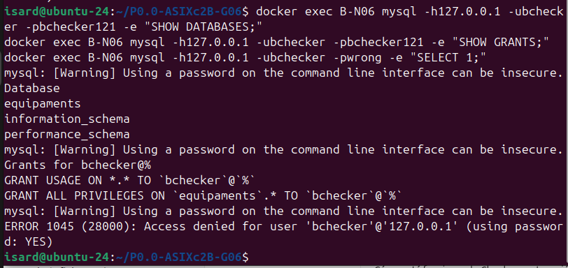

# Base de dades MySQL (B-N06)

| | |
|---|---|
| **Projecte** | P0.0 · Desplegament d'infraestructura |
| **Mòdul** | 0379 · Projecte intermodular (ASIX) |
| **Equip** | G06 (ASIXc2B) · identificador N06 |
| **Autor** | Josep Pérez |
| **Versió** | 1.0 · 16/11/2026 · Sprint 2 |

## Índex
1. [Objectiu i abast](#1-objectiu-i-abast)
2. [Característiques](#2-característiques)
3. [Implementació](#3-implementació)
4. [Desplegament i proves](#4-desplegament-i-proves)
5. [Resolució de problemes](#5-resolució-de-problemes)
6. [Historial de versions](#6-historial-de-versions)

## 1. Objectiu i abast
Aquest document descriu el servidor de base de dades `B-N06`: què conté, com es crea i com es comprova que funciona. La càrrega de les dades del CSV es documenta al [document 05](05-carrega-csv.md). L'accés de l'aplicació web i la regla del firewall que deixa la DMZ consultar-lo es documenten amb les seves tasques.

## 2. Característiques
| Element | Valor |
|---|---|
| Contenidor | `B-N06`, imatge construïda sobre la imatge base amb `mysql-server` i `mysql-client` |
| Xarxa i adreça | Intranet · 10.213.2.10 (gateway: el router, 10.213.2.254) |
| Versió | MySQL 8.0 |
| Base de dades | `equipaments` (`utf8mb4`) |
| Usuari de la pràctica | `bchecker` / `bchecker121`, amb tots els permisos sobre `equipaments`, des de qualsevol adreça |
| Persistència | Volum Docker `db-data` (`/var/lib/mysql`): les dades sobreviuen a un reinici o a recrear el contenidor |

L'usuari usa `mysql_native_password` perquè és compatible amb tots els clients de la pràctica (vegeu l'[estudi previ](09-estudi-previ.md), apartat 9.3). La base de dades només és accessible des de la intranet; la DMZ s'hi obrirà més endavant amb una regla concreta pel port 3306.

## 3. Implementació
| Fitxer | Contingut |
|---|---|
| `services/db/init.sh` | Inicialitza el *datadir* la primera vegada, arrenca MySQL de forma temporal i hi aplica `init.sql`. És idempotent: es pot executar a cada arrencada |
| `services/db/init.sql` | Crea la base de dades i l'usuari `bchecker` amb els permisos. Les variables (`DB_NAME`, `DB_USER`, `DB_PASS`) vénen del `docker-compose.yml` |
| `docker-compose.yml` | Servei `db`: imatge, variables, volum, xarxa i `healthcheck` |

L'entrypoint de la imatge base executa `/opt/init.sh` en arrencar i després deixa el procés `mysqld` com a principal. El `healthcheck` fa un `mysqladmin ping` amb l'usuari `bchecker`, i el contenidor no passa a `healthy` fins que MySQL accepta connexions.

## 4. Desplegament i proves
```bash
docker compose up -d --build --wait db
docker compose ps
```
La primera vegada triga una mica més (inicialització del *datadir*) fins que l'estat és `healthy`. En la prova feta amb un volum nou i la imatge ja construïda, va trigar uns 7 segons.

Les proves s'executen dins del contenidor `B-N06`, que porta el client `mysql`. La comprovació des d'un altre equip de la xarxa es farà amb el client Linux, quan tingui el client MySQL.

### 4.1 Accés amb l'usuari bchecker
```bash
docker exec B-N06 mysql -h127.0.0.1 -ubchecker -pbchecker121 -e "SHOW DATABASES;"
```
Resultat esperat: la llista de bases de dades amb `equipaments`.

### 4.2 Permisos
```bash
docker exec B-N06 mysql -h127.0.0.1 -ubchecker -pbchecker121 -e "SHOW GRANTS;"
docker exec B-N06 mysql -h127.0.0.1 -ubchecker -pwrong -e "SELECT 1;"
```
Resultat esperat: la primera mostra `GRANT ALL PRIVILEGES ON equipaments.*`; la segona falla amb `Access denied`.



*Figura 1. Accés amb `bchecker`, permisos i error d'accés amb una contrasenya incorrecta (16/11/2026).*

### 4.3 Les dades persisteixen
```bash
docker exec B-N06 mysql -h127.0.0.1 -ubchecker -pbchecker121 equipaments -e "CREATE TABLE IF NOT EXISTS prova (id INT); SHOW TABLES;"
docker compose up -d --force-recreate --wait db
docker exec B-N06 mysql -h127.0.0.1 -ubchecker -pbchecker121 equipaments -e "SHOW TABLES; DROP TABLE prova;"
```
Resultat esperat: la taula `prova` continua existint després de recrear el contenidor. L'opció `--wait` fa que `docker compose` no torni fins que el contenidor és `healthy`; sense ella, la darrera comanda pot fallar amb `Can't connect to MySQL server` perquè MySQL encara s'està iniciant.


*Figura 2. La taula `prova` continua existint després de recrear el contenidor (16/11/2026).*

## 5. Resolució de problemes
| Símptoma | Causa probable | Solució |
|---|---|---|
| El contenidor no passa a `healthy` | MySQL encara s'està inicialitzant o `init.sql` ha fallat | `docker logs B-N06` i `docker exec B-N06 cat /var/log/mysql-init.log` |
| `Can't connect to MySQL server` des d'un altre equip | L'equip no arriba a 10.213.2.10 | Comprovar que `B-N06` està `healthy` i que l'equip és a la intranet |
| `Access denied for user 'bchecker'` | Contrasenya incorrecta o volum antic amb altres dades | Revisar les variables del `docker-compose.yml`; per començar de zero, `docker compose rm -sf db && docker volume rm p00-n06_db-data` |
| `Plugin caching_sha2_password could not be loaded` | L'usuari no és `mysql_native_password` | Tornar a aplicar `init.sql` (recrear el contenidor) |

## 6. Historial de versions
| Versió | Data | Canvis |
|---|---|---|
| 1.0 | 16/11/2026 | Primera versió: servidor MySQL, base de dades `equipaments` i usuari `bchecker` |
