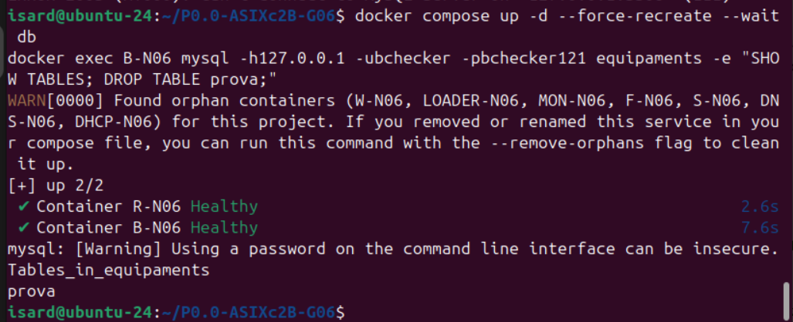
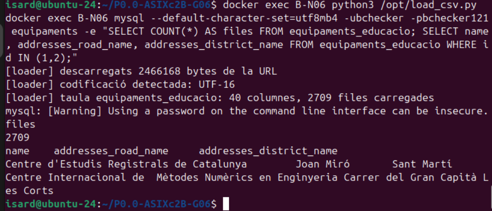

# Base de dades MySQL (B-N06) i càrrega del CSV

| | |
|---|---|
| **Projecte** | P0.0 · Desplegament d'infraestructura |
| **Mòdul** | 0379 · Projecte intermodular (ASIX) |
| **Equip** | G06 (ASIXc2B) · identificador N06 |
| **Autor** | Josep Pérez |
| **Versió** | 2.0 · 23/11/2026 · Sprint 2 |

## Índex
1. [Objectiu i abast](#1-objectiu-i-abast)
2. [Característiques](#2-característiques)
3. [Implementació](#3-implementació)
4. [Desplegament i proves](#4-desplegament-i-proves)
5. [Càrrega del CSV](#5-càrrega-del-csv)
6. [Resolució de problemes](#6-resolució-de-problemes)
7. [Referències](#7-referències)
8. [Historial de versions](#8-historial-de-versions)

## 1. Objectiu i abast
Aquest document descriu el servidor de base de dades `B-N06`: què conté, com es crea i com es comprova que funciona. També descriu la càrrega al servidor del llistat d'equipaments d'educació de la ciutat de Barcelona (Open Data BCN), que demana l'enunciat (apartat 5). L'aplicació web que mostra aquestes dades és al [document 06](06-aplicacio-web.md), i la regla del firewall que deixa la DMZ consultar la BBDD és a l'[arquitectura](01-arquitectura.md#6-política-del-firewall).

## 2. Característiques
| Element | Valor |
|---|---|
| Contenidor | `B-N06`, imatge construïda sobre la imatge base amb `mysql-server`, `mysql-client`, `python3` i `python3-pymysql` (via l'argument `PKGS` del `docker-compose.yml`) |
| Xarxa i adreça | Intranet · 10.213.2.10 (gateway: el router, 10.213.2.254) |
| Versió | MySQL 8.0 |
| Base de dades | `equipaments` (`utf8mb4`) |
| Usuari de la pràctica | `bchecker` / `bchecker121`, amb tots els permisos sobre `equipaments`, des de qualsevol adreça |
| Persistència | Volum Docker `db-data` (`/var/lib/mysql`): les dades sobreviuen a un reinici o a recrear el contenidor |

L'usuari usa `mysql_native_password` perquè és compatible amb tots els clients de la pràctica (vegeu l'[estudi previ](09-estudi-previ.md), apartat 9.3). La base de dades és accessible des de la intranet i, pel port 3306, des de la DMZ (regla del router que fa servir l'aplicació web).

## 3. Implementació
| Fitxer | Contingut |
|---|---|
| `services/db/init.sh` | Inicialitza el *datadir* la primera vegada, arrenca MySQL de forma temporal i hi aplica `init.sql`. És idempotent: es pot executar a cada arrencada |
| `services/db/init.sql` | Crea la base de dades i l'usuari `bchecker` amb els permisos. Les variables (`DB_NAME`, `DB_USER`, `DB_PASS`) vénen del `docker-compose.yml` |
| `services/db/load_csv.py` | Script de càrrega del CSV (apartat 5). Es munta de només lectura al contenidor com a `/opt/load_csv.py` |
| `docker-compose.yml` | Servei `db`: imatge, variables, volum, xarxa i `healthcheck` |

L'entrypoint de la imatge base executa `/opt/init.sh` en arrencar i després deixa el procés `mysqld` com a principal. El `healthcheck` fa un `mysqladmin ping` amb l'usuari `bchecker`, i el contenidor no passa a `healthy` fins que MySQL accepta connexions.

## 4. Desplegament i proves
```bash
docker compose up -d --build --wait db
docker compose ps
```
La primera vegada triga una mica més (inicialització del *datadir*) fins que l'estat és `healthy`. En la prova feta amb un volum nou i la imatge ja construïda, va trigar uns 7 segons.

Les proves s'executen dins del contenidor `B-N06`, que porta el client `mysql`. La comprovació des del client Linux és al [document dels clients](04-clients-isard.md#53-accés-a-la-base-de-dades-i-al-sistema).

### 4.1 Accés amb l'usuari bchecker
```bash
docker exec B-N06 mysql -h127.0.0.1 -ubchecker -pbchecker121 -e "SHOW DATABASES;"
```
Resultat esperat: la llista de bases de dades amb `equipaments`.

### 4.2 Permisos
```bash
docker exec B-N06 mysql -h127.0.0.1 -ubchecker -pbchecker121 -e "SHOW GRANTS;"
docker exec B-N06 mysql -h127.0.0.1 -ubchecker -pwrong -e "SELECT 1;"
```
Resultat esperat: la primera mostra `GRANT ALL PRIVILEGES ON equipaments.*`; la segona falla amb `Access denied`.


*Figura 1. Accés amb `bchecker`, permisos i error d'accés amb una contrasenya incorrecta (16/11/2026).*

### 4.3 Les dades persisteixen
```bash
docker exec B-N06 mysql -h127.0.0.1 -ubchecker -pbchecker121 equipaments -e "CREATE TABLE IF NOT EXISTS prova (id INT); SHOW TABLES;"
docker compose up -d --force-recreate --wait db
docker exec B-N06 mysql -h127.0.0.1 -ubchecker -pbchecker121 equipaments -e "SHOW TABLES; DROP TABLE prova;"
```
Resultat esperat: la taula `prova` continua existint després de recrear el contenidor. L'opció `--wait` fa que `docker compose` no torni fins que el contenidor és `healthy`; sense ella, la darrera comanda pot fallar amb `Can't connect to MySQL server` perquè MySQL encara s'està iniciant.



*Figura 2. La taula `prova` continua existint després de recrear el contenidor (16/11/2026).*

## 5. Càrrega del CSV
### 5.1 Requisits i dependències
| Requisit | Detall |
|---|---|
| Servidor de BBDD | `B-N06` en marxa i en estat `healthy` |
| Python i PyMySQL | `python3` i `python3-pymysql` (a la imatge de la BBDD, via l'argument `PKGS` del `docker-compose.yml`). Versió comprovada: PyMySQL 1.0.2 |
| Accés al CSV | Descàrrega des d'Open Data BCN (el contenidor ha de sortir a Internet pel router) o, si no és possible, un fitxer local a `data/equipaments.csv` |
| Variables | `DB_USER`, `DB_PASS` i `DB_NAME` (ja definides al servei `db`). Opcionals: `DB_HOST` (per defecte `127.0.0.1`), `CSV_URL`, `CSV_FILE` (per defecte `/data/equipaments.csv`) i `DB_TABLE` (per defecte `equipaments_educacio`) |

### 5.2 Funcionament
El script és a `services/db/load_csv.py` i s'executa dins del mateix contenidor que la base de dades, de manera que no cal cap contenidor ni adreça IP més.

Passos:
1. **Obté el CSV.** Descarrega l'adreça de l'enunciat. Si la descàrrega falla, fa servir el fitxer local `CSV_FILE`.
2. **Detecta la codificació.** Reconeix UTF-16 (el que usa aquest fitxer), UTF-8 i, si no és UTF-8 vàlid, Windows-1252.
3. **Neteja el text.** Treu els bytes nuls i els caràcters BOM (U+FEFF) que el fitxer porta dins de les dades.
4. **Detecta el separador** del CSV amb `csv.Sniffer`.
5. **Crea la taula** `equipaments_educacio` a partir de la capçalera: els noms de columna es passen a minúscules, sense accents i amb guions baixos (per exemple, `addresses_road_name`). Totes les columnes són de tipus `TEXT`, més una clau `id` autoincremental.
6. **Insereix les files** en lots de 500 i fa un únic `COMMIT` al final.

Es va descartar un contenidor de càrrega a part (`LOADER-N06`, previst al principi) perquè afegia una imatge, una IP i un permís d'accés sense aportar res: el script necessita només el client de la base de dades i les seves credencials.

### 5.3 Estructura de la taula
La taula té 40 columnes, que provenen directament de la capçalera del CSV:

| Grup | Columnes |
|---|---|
| Identificació | `register_id`, `name`, `institution_id`, `institution_name`, `created`, `modified` |
| Adreça | `addresses_roadtype_id`, `addresses_roadtype_name`, `addresses_road_id`, `addresses_road_name`, `addresses_start_street_number`, `addresses_end_street_number`, `addresses_neighborhood_id`, `addresses_neighborhood_name`, `addresses_district_id`, `addresses_district_name`, `addresses_zip_code`, `addresses_town`, `addresses_main_address`, `addresses_type` |
| Valors (telèfon, etc.) | `values_id`, `values_attribute_id`, `values_category`, `values_attribute_name`, `values_value`, `values_outstanding`, `values_description` |
| Filtres | `secondary_filters_id`, `secondary_filters_name`, `secondary_filters_fullpath`, `secondary_filters_tree`, `secondary_filters_asia_id` |
| Coordenades | `geo_epgs_25831_x`, `geo_epgs_25831_y`, `geo_epgs_4326_lat`, `geo_epgs_4326_lon` |
| Dates i horari | `estimated_dates`, `start_date`, `end_date`, `timetable` |

Com que tot és text, no hi ha conversió de tipus (números, dates). Per mostrar les dades a la web n'hi ha prou; si es volgués fer càlculs amb les coordenades o les dates, caldria convertir-les.

### 5.4 Execució
Des de l'equip dels serveis, amb `B-N06` en marxa:

```bash
docker compose up -d --build --wait db
docker exec B-N06 python3 /opt/load_csv.py
```

Sortida esperada:
```
[loader] descarregats N bytes de la URL
[loader] codificació detectada: UTF-16
[loader] taula equipaments_educacio: 40 columnes, M files carregades
```

> **Atenció:** el script fa `DROP TABLE IF EXISTS` i torna a crear la taula a cada execució. Qualsevol canvi manual a la taula es perd. Vegeu l'apartat 5.8.

### 5.5 Si no hi ha accés a Internet
Es baixa el CSV des de l'equip dels serveis (que sí que té Internet) i s'indica al script que no el descarregui:

```bash
curl -L -A "Mozilla/5.0" -o data/equipaments.csv "https://opendata-ajuntament.barcelona.cat/data/dataset/f36b60f2-9541-4d08-b0f9-b0a9313fab3d/resource/29d9ff10-6892-4f16-9012-d5c4997857e7/download"
docker exec -e CSV_URL= B-N06 python3 /opt/load_csv.py
```

La carpeta `data/` es munta de només lectura a `/data`. Els fitxers `*.csv` d'aquesta carpeta no es pugen al repositori.

### 5.6 Verificació i resultats observats
Es van executar les comandes següents el 19/11/2026, a l'equip dels serveis:

```bash
docker exec B-N06 mysql --default-character-set=utf8mb4 -ubchecker -pbchecker121 equipaments \
  -e "SELECT COUNT(*) AS files FROM equipaments_educacio;"
docker exec B-N06 mysql --default-character-set=utf8mb4 -ubchecker -pbchecker121 equipaments \
  -e "SELECT name, addresses_road_name, addresses_district_name FROM equipaments_educacio WHERE id IN (1,2);"
docker exec B-N06 mysql --default-character-set=utf8mb4 -ubchecker -pbchecker121 equipaments \
  -e "SELECT COUNT(*) AS amb_bom FROM equipaments_educacio WHERE HEX(register_id) LIKE '%EFBBBF%';"
```

| Comprovació | Resultat observat |
|---|---|
| Fitxer descarregat | 2.466.168 bytes |
| Codificació detectada | UTF-16 |
| Columnes creades | 40 |
| Files carregades (`SELECT COUNT(*)`) | 2.709 (més de 0) |
| Files amb el caràcter invisible a `register_id` | 0 |
| Accents | Correctes, per exemple `Joan Miró`, `Sant Martí` i `Carrer del Gran Capità` |



*Figura 3. Càrrega del CSV, recompte de files i accents correctes (19/11/2026).*

### 5.7 Temps de càrrega (criteri P5)
El [criteri P5](15-criteris-rendiment-disponibilitat.md) demana 60 s o menys. Es mesura amb:

```bash
time docker exec B-N06 python3 /opt/load_csv.py
```

Resultat observat el 19/11/2026 (descàrrega, conversió i inserció de les 2.709 files): `real 0m1,019s`. Compleix el criteri (60 s o menys). És una sola mesura, feta amb la xarxa del laboratori; no s'ha repetit.

### 5.8 Seguretat i manteniment
- **La taula es recrea a cada execució.** Abans de tornar a carregar si hi ha dades que cal conservar, se'n fa una còpia:
  ```bash
  docker exec B-N06 mysqldump -ubchecker -pbchecker121 equipaments equipaments_educacio > copia-equipaments.sql
  ```
  La restauració d'aquesta còpia no s'ha provat (vegeu la prova C4 del [pla de proves](15-criteris-rendiment-disponibilitat.md#7-pla-de-proves)).
- Les credencials són les de la pràctica (`bchecker`, imposades per l'enunciat) i es llegeixen de les variables d'entorn del contenidor, no del codi del script.
- El script depèn d'Open Data BCN: si canvia el format o l'adreça del CSV, la càrrega pot fallar o crear columnes diferents. Per això les columnes es creen a partir de la capçalera.
- Les consultes de l'aplicació web han de fer servir els noms de columna normalitzats (apartat 5.3).

## 6. Resolució de problemes
| Símptoma | Causa probable | Solució |
|---|---|---|
| El contenidor no passa a `healthy` | MySQL encara s'està inicialitzant o `init.sql` ha fallat | `docker logs B-N06` i `docker exec B-N06 cat /var/log/mysql-init.log` |
| `Can't connect to MySQL server` des d'un altre equip | L'equip no arriba a 10.213.2.10 | Comprovar que `B-N06` està `healthy` i que l'equip és a la intranet |
| `Access denied for user 'bchecker'` | Contrasenya incorrecta o volum antic amb altres dades | Revisar les variables del `docker-compose.yml`; per començar de zero, `docker compose rm -sf db && docker volume rm p00-n06_db-data` |
| `Plugin caching_sha2_password could not be loaded` | L'usuari no és `mysql_native_password` | Tornar a aplicar `init.sql` (recrear el contenidor) |
| `[loader] no s'ha pogut descarregar (<urlopen error timed out>)` | Amb la intranet configurada com a `ipvlan`, el trànsit del contenidor cap a Internet no passava pel router ([clients](04-clients-isard.md), apartat 3.2) | Canvi de la xarxa dels clients a enrutament: després el contenidor surt a Internet pel router i la descàrrega funciona |
| Els accents es mostren com a `�` en consultar | El client `mysql` del contenidor no feia servir `utf8mb4` | Afegir `--default-character-set=utf8mb4` a les comandes. No es va poder comprovar si les dades de la primera càrrega eren correctes, perquè la càrrega es va repetir |
| `register_id` començava amb un caràcter invisible (`HEX` = `EFBBBF...`) | El CSV porta un BOM (U+FEFF) a dins de les dades; una cerca per `register_id` no hauria trobat res | El script treu el caràcter U+FEFF abans de llegir el CSV (comprovat: 0 files afectades) |

## 7. Referències
- [Equipaments d'educació, Open Data BCN](https://opendata-ajuntament.barcelona.cat/data/es/dataset/equipament-educacio/resource/29d9ff10-6892-4f16-9012-d5c4997857e7)
- [PyMySQL](https://pymysql.readthedocs.io/)
- [Mòdul `csv` de Python](https://docs.python.org/3/library/csv.html)

## 8. Historial de versions
| Versió | Data | Canvis |
|---|---|---|
| 1.0 | 16/11/2026 | Primera versió: servidor MySQL, base de dades `equipaments` i usuari `bchecker` |
| 1.1 | 19/11/2026 | Script de càrrega del CSV, verificació (2.709 files) i problemes trobats (abans, document 05) |
| 2.0 | 23/11/2026 | S'hi integra la càrrega del CSV (abans en un document a part) i s'actualitza l'accés des de la DMZ |
