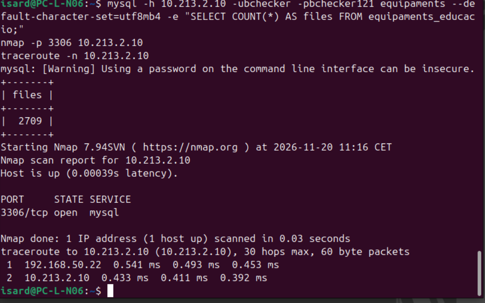

# Clients a Isard (xarxa itb 6)

| | |
|---|---|
| **Projecte** | P0.0 · Desplegament d'infraestructura |
| **Mòdul** | 0379 · Projecte intermodular (ASIX) |
| **Equip** | G06 (ASIXc2B) · identificador N06 |
| **Autor** | Josep Pérez |
| **Versió** | 1.2 · 20/11/2026 · Sprint 2 |

## Índex
1. [Objectiu i abast](#1-objectiu-i-abast)
2. [Visió general](#2-visió-general)
3. [Connexió dels clients amb la intranet](#3-connexió-dels-clients-amb-la-intranet)
4. [Client Linux (PC-L-N06)](#4-client-linux-pc-l-n06)
5. [Proves](#5-proves)
6. [Client Windows (PC-W-N06)](#6-client-windows-pc-w-n06)
7. [Resolució de problemes](#7-resolució-de-problemes)
8. [Historial de versions](#8-historial-de-versions)

## 1. Objectiu i abast
L'enunciat demana dos PC, un Windows i un Linux. En aquest projecte no són contenidors: són **màquines virtuals independents al laboratori d'Isard** que arriben als serveis Docker per la xarxa `itb 6`. Aquest document explica com es connecten, com es configura cada client i com es comprova que funcionen.

## 2. Visió general
| Equip | Sistema | Nom | Adreça a itb 6 | Estat |
|---|---|---|---|---|
| Equip dels serveis | Ubuntu 24 (Docker) | `ubuntu-24.04-desktop` (al *prompt* surt com a `ubuntu-24`) | 192.168.50.22/24 (`enp3s0`) | Fet |
| Client Linux | Ubuntu 24 | `PC-L-N06` | 192.168.50.50/24 | Verificat el 20/11/2026 (apartat 5) |
| Client Windows | Windows | `PC-W-N06` | 192.168.50.60/24 | Pendent |

La VM del client Linux té **una sola targeta de xarxa**, la d'`itb 6` (`enp1s0` en aquesta VM; el nom de la targeta pot ser diferent segons la VM, es veu amb `ip -br addr`). Abans de fixar les adreces .50 i .60 es va comprovar amb `ping` que cap altre equip d'`itb 6` no les feia servir.

## 3. Connexió dels clients amb la intranet
Els clients són a `itb 6` (192.168.50.0/24) i els contenidors a la intranet (10.213.2.0/24). L'equip dels serveis, que és a les dues xarxes, fa de *gateway*:

```
Client (192.168.50.50)  --itb 6-->  Equip dels serveis (enp3s0 .22 · br-intranet 10.213.2.1)  -->  contenidors
         ^                                                                                         |
         '------------------------------ resposta pel router (R-N06) ----------------------------'
```

| Peça | On | Què fa |
|---|---|---|
| Ruta `10.213.2.0/24 via 192.168.50.22` | Cada client | Envia el trànsit de la intranet a l'equip dels serveis |
| `scripts/xarxa-clients.sh` | Equip dels serveis | Activa el reenviament i obre `DOCKER-USER` entre `enp3s0` i `br-intranet` |
| `192.168.50.0/24 via 10.213.2.1` | Router (`services/router/init.sh`) | Les respostes tornen cap a l'equip dels serveis |
| `gateway_mode_ipv4: nat-unprotected` | Xarxa `intranet` (`docker-compose.yml`) | Permet l'accés directe a les IP dels contenidors |
| `scripts/xarxa-clients.sh --internet` | Equip dels serveis | Deixa sortir els clients a Internet pel seu compte, amb NAT |

La xarxa `intranet` és un pont normal amb nom fix (`br-intranet`). Després de cada `docker compose up` cal executar el script a l'equip dels serveis:

```bash
sudo ./scripts/xarxa-clients.sh --internet
```

L'opció `--internet` només cal si els clients han de sortir a Internet (per instal·lar paquets). Sense ella, només s'obre el pas cap a la intranet. El script és idempotent. Les regles no sobreviuen a un reinici de l'equip ni a recrear la xarxa.

### 3.1 Sortida a Internet dels clients
Els clients només tenen la targeta d'`itb 6`, de manera que no tenen sortida directa a Internet. Per instal·lar paquets, surten **a través de l'equip dels serveis** (amb NAT), no pel router de la pràctica. És una decisió de laboratori: el router només controla el trànsit entre la DMZ, la intranet i NAT dels contenidors. El client ha de tenir `192.168.50.22` com a *gateway* i un servidor DNS (per exemple, 1.1.1.1).

### 3.2 Per què no s'ha connectat la targeta directament a la intranet
Es van provar dues opcions abans:

- **Pont (*bridge*) amb la targeta d'`itb 6`.** Els clients enviaven l'ARP i el contenidor responia, però la resposta no arribava. La captura amb `tcpdump` mostrava la resposta sortint amb la MAC del contenidor, diferent de la de la targeta virtual. Probablement la xarxa virtual d'Isard descarta els paquets amb una MAC d'origen que no és la de la targeta (és una deducció a partir de les proves).
- **`ipvlan` L2.** Els clients arribaven als contenidors, però el trànsit que havia de passar pel router no hi arribava: `ipvlan` lliura els paquets segons la IP de destí, i un paquet cap a Internet o cap a la DMZ no té cap contenidor com a destí, de manera que sortia per la targeta `enp3s0` (es va comprovar amb `tcpdump`). Això hauria impedit que la web de la DMZ arribés a la BBDD.

### 3.3 Docker 28 i l'enrutament directe
Des de Docker 28, Docker afegeix a la taula `raw` regles `PREROUTING ... -j DROP` que descarten el trànsit cap a les IP dels contenidors si no arriba pel seu pont. Aquestes regles s'apliquen abans de `DOCKER-USER`, així que no es poden contrarestar des d'allà. Per això la xarxa `intranet` usa el mode `nat-unprotected`. Es comprova que les regles han desaparegut:

```bash
sudo iptables -t raw -S
```

Només han de quedar les de les xarxes `dmz` i `nat`, no les de la intranet.

### 3.4 Limitacions
- El DHCP de la intranet no pot repartir adreces als clients, perquè la difusió no travessa l'enrutament. Els clients tenen l'adreça fixa.
- Les adreces 192.168.50.x són les del laboratori d'Isard. En un altre entorn cal canviar-les al script, al router i als clients.

## 4. Client Linux (PC-L-N06)
### 4.1 Màquina virtual
Ubuntu 24 amb una sola targeta de xarxa, la d'`itb 6` (`enp1s0`).

### 4.2 Configuració de la xarxa
La targeta d'`itb 6` pot tenir una MTU de 8946, i el pont de Docker usa 1500. Es fixa a 1500 al client perquè els paquets grans no es perdin. L'adreça és fixa, amb l'equip dels serveis com a *gateway* i la ruta cap a la intranet:

```bash
sudo hostnamectl set-hostname PC-L-N06
IF=enp1s0                      # la targeta d'itb 6 (ip -br addr)
CON=$(nmcli -g GENERAL.CONNECTION device show "$IF")
sudo nmcli con mod "$CON" ipv4.method manual ipv4.addresses 192.168.50.50/24 \
  ipv4.gateway 192.168.50.22 ipv4.dns 1.1.1.1 \
  ipv4.routes "10.213.2.0/24 192.168.50.22" 802-3-ethernet.mtu 1500
sudo nmcli con up "$CON"
ip -br addr
ip route
ip link show "$IF" | grep -o "mtu [0-9]*"
```
Resultat observat el 20/11/2026 a la VM: `enp1s0` amb `192.168.50.50/24`, `mtu 1500`, i les rutes `default via 192.168.50.22` i `10.213.2.0/24 via 192.168.50.22`.

### 4.3 Usuari bchecker
L'enunciat demana l'usuari `bchecker` a tots els sistemes:
```bash
sudo useradd -m -s /bin/bash -G sudo bchecker
echo 'bchecker:bchecker121' | sudo chpasswd
id bchecker
```
Si l'usuari ja existeix, `useradd` ho diu i només cal la segona línia. Ubuntu pot avisar que la contrasenya conté el nom d'usuari (`CONTRASENYA DOLENTA`); és només un avís de qualitat. Es va comprovar que la contrasenya funciona amb `su - bchecker -c "whoami"` (apartat 5.3).

### 4.4 Eines de prova
```bash
sudo apt-get update
sudo apt-get install -y nmap mysql-client ftp traceroute
for c in nmap mysql ftp traceroute; do printf "%s: " $c; which $c || echo NO; done
```
Els paquets es descarreguen per Internet, que els clients tenen a través de l'equip dels serveis (apartat 3.1). A la VM de proves ja hi eren instal·lats.

## 5. Proves
Es fan des del client Linux, amb l'equip dels serveis ja preparat (`sudo ./scripts/xarxa-clients.sh --internet`).

### 5.1 Connexió amb la intranet
```bash
ping -c 3 192.168.50.22
ping -c 3 10.213.2.254
ping -c 3 10.213.2.10
```
Resultat observat el 20/11/2026: 0 % de paquets perduts als tres, amb una latència mitjana d'uns 0,4 ms. El `ttl` de la resposta del router és 63 i el de la BBDD 62: la resposta de la BBDD torna pel router, tal com està dissenyat.

### 5.2 Sortida a Internet
Des del client: `sudo apt-get update` va baixar 12,2 MB, de manera que la sortida pel NAT de l'equip dels serveis funciona.

La sortida a Internet de la intranet **pel router** es comprova des d'un contenidor, a l'equip dels serveis:
```bash
docker exec B-N06 ip route show default
docker exec B-N06 ping -c 3 1.1.1.1
```
Resultat esperat: `default via 10.213.2.254` i cap paquet perdut.

### 5.3 Accés a la base de dades i al sistema
```bash
mysql -h 10.213.2.10 -ubchecker -pbchecker121 -e "SHOW DATABASES;"
mysql -h 10.213.2.10 -ubchecker -pbchecker121 equipaments --default-character-set=utf8mb4 \
  -e "SELECT COUNT(*) AS files FROM equipaments_educacio;"
nmap -p 3306 10.213.2.10
traceroute -n 10.213.2.10
su - bchecker -c "whoami"
```

| Prova | Resultat observat (20/11/2026) |
|---|---|
| `SHOW DATABASES` | Llista `equipaments`, `information_schema` i `performance_schema` |
| `SELECT COUNT(*)` | 2.709 files |
| `nmap -p 3306` | `3306/tcp open mysql`, amb una latència inferior a 1 ms |
| `traceroute -n` | Dos salts: `192.168.50.22` (equip dels serveis) i `10.213.2.10` |
| `su - bchecker -c "whoami"` | Accepta la contrasenya i mostra `bchecker` |



*Figura 1. Proves del client Linux (20/11/2026).*

## 6. Client Windows (PC-W-N06)
Pendent. Procediment previst:
1. Màquina virtual Windows a Isard amb la targeta d'`itb 6`.
2. Adreça fixa 192.168.50.60/24, amb 192.168.50.22 com a *gateway* i la ruta cap a la intranet.
3. MTU a 1500 i ruta cap a la intranet, des d'una consola d'administrador (el nom de la targeta es veu amb `netsh interface ipv4 show interfaces`):
```
netsh interface ipv4 set subinterface "<nom de la targeta>" mtu=1500 store=persistent
route -p add 10.213.2.0 mask 255.255.255.0 192.168.50.22
```
4. Usuari `bchecker` (`net user bchecker bchecker121 /add`) amb els permisos necessaris per entrar a l'equip.
5. Les mateixes proves de l'apartat 5, amb `ping` i `Test-NetConnection -ComputerName 10.213.2.10 -Port 3306`.

## 7. Resolució de problemes
| Símptoma | Causa probable | Solució |
|---|---|---|
| El client no arriba a 10.213.2.x i els comptadors de `iptables -vnL DOCKER-USER` són 0 | Les regles `raw` de Docker 28 descarten el trànsit | `sudo iptables -t raw -S`: no ha de tenir regles `DROP` de la intranet. Comprovar `gateway_mode_ipv4: nat-unprotected` al compose i recrear la xarxa (`docker compose down` i `up`) |
| Els comptadors de `DOCKER-USER` pugen però no hi ha resposta | El router no té la ruta de tornada | `docker exec R-N06 ip route`: ha de tenir `192.168.50.0/24 via 10.213.2.1` |
| Funcionava i ha deixat de funcionar després d'un reinici o d'un `docker compose up` | S'han perdut les regles de l'equip dels serveis | `sudo ./scripts/xarxa-clients.sh --internet` |
| El client no té Internet (`apt-get update` falla) | Falta l'opció `--internet`, el *gateway* del client no és 192.168.50.22 o no hi ha DNS | Executar el script amb `--internet` i comprovar `ip route` i `nmcli -g ipv4.dns con show <connexió>` |
| El client no arriba ni a `192.168.50.22` | Adreça o targeta del client incorrectes | `ip -br addr` (el nom de la targeta pot ser `enp1s0` o `enp3s0` segons la VM) i `ip neigh show` |
| Les connexions petites van bé però les grans es queden penjades | La MTU del client és 8946 | Posar la MTU del client a 1500 (apartat 4.2) |
| Les ordres de l'equip dels serveis fallen amb `No chain/target/match by that name` | S'han executat al client (no té `DOCKER-USER`) | Executar-les a l'equip dels serveis (el *prompt* ha de dir `isard@ubuntu-24`, no `isard@PC-L-N06`) |
| El script diu que no existeix el pont `br-intranet` | La infraestructura no està aixecada | `docker compose up -d` i tornar a executar el script |
| Error en crear la xarxa `intranet` perquè ja existeix amb un altre tipus | Queda una xarxa antiga (`ipvlan`) d'una versió anterior | `docker compose down --remove-orphans` i tornar a aixecar |

## 8. Historial de versions
| Versió | Data | Canvis |
|---|---|---|
| 1.0 | 17/11/2026 | Primera versió: connexió per itb 6 amb `ipvlan` i configuració del client Linux |
| 1.1 | 18/11/2026 | Els clients arriben a la intranet per enrutament a través de l'equip dels serveis, amb adreces d'itb 6, perquè `ipvlan` impedia el pas pel router |
| 1.2 | 20/11/2026 | Client Linux verificat (BBDD, port 3306, ruta i usuari `bchecker`); una sola targeta (`enp1s0`); sortida a Internet pel NAT de l'equip dels serveis (`--internet`) |
