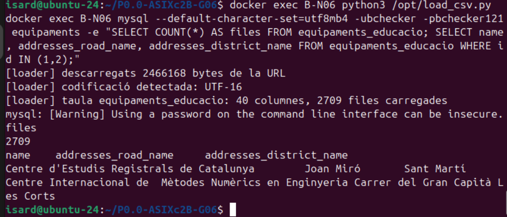

# Càrrega del CSV d'equipaments a MySQL

| | |
|---|---|
| **Projecte** | P0.0 · Desplegament d'infraestructura |
| **Mòdul** | 0379 · Projecte intermodular (ASIX) |
| **Equip** | G06 (ASIXc2B) · identificador N06 |
| **Autor** | Josep Pérez |
| **Versió** | 1.0 · 19/11/2026 · Sprint 2 |

## Índex
1. [Objectiu i abast](#1-objectiu-i-abast)
2. [Requisits i dependències](#2-requisits-i-dependències)
3. [Funcionament](#3-funcionament)
4. [Execució](#4-execució)
5. [Verificació i resultats observats](#5-verificació-i-resultats-observats)
6. [Problemes trobats i resolució](#6-problemes-trobats-i-resolució)
7. [Seguretat i manteniment](#7-seguretat-i-manteniment)
8. [Referències](#8-referències)
9. [Historial de versions](#9-historial-de-versions)

## 1. Objectiu i abast
L'enunciat demana carregar a la base de dades el llistat d'equipaments d'educació de la ciutat de Barcelona (Open Data BCN). Aquest document descriu el script que ho fa, com s'executa i com es comprova que les dades hi són. La base de dades és la de [B-N06](03-bbdd-mysql.md).

## 2. Requisits i dependències
| Requisit | Detall |
|---|---|
| Servidor de BBDD | `B-N06` en marxa i en estat `healthy` |
| Python i PyMySQL | `python3` i `python3-pymysql` (a la imatge de la BBDD, via l'argument `PKGS` del `docker-compose.yml`). Versió comprovada: PyMySQL 1.0.2 |
| Accés al CSV | Descàrrega des d'Open Data BCN (el contenidor ha de sortir a Internet pel router) o, si no és possible, un fitxer local a `data/equipaments.csv` |
| Variables | `DB_USER`, `DB_PASS` i `DB_NAME` (ja definides al servei `db`). Opcionals: `DB_HOST` (per defecte `127.0.0.1`), `CSV_URL`, `CSV_FILE` (per defecte `/data/equipaments.csv`) i `DB_TABLE` (per defecte `equipaments_educacio`) |

## 3. Funcionament
El script és a `services/db/load_csv.py` i es munta de només lectura dins del contenidor `B-N06` com a `/opt/load_csv.py`. S'executa dins del mateix contenidor que la base de dades, de manera que no cal cap contenidor ni adreça IP més.

Passos:
1. **Obté el CSV.** Descarrega l'adreça de l'enunciat. Si la descàrrega falla, fa servir el fitxer local `CSV_FILE`.
2. **Detecta la codificació.** Reconeix UTF-16 (el que usa aquest fitxer), UTF-8 i, si no és UTF-8 vàlid, Windows-1252.
3. **Neteja el text.** Treu els bytes nuls i els caràcters BOM (U+FEFF) que el fitxer porta dins de les dades.
4. **Detecta el separador** del CSV amb `csv.Sniffer`.
5. **Crea la taula** `equipaments_educacio` a partir de la capçalera: els noms de columna es passen a minúscules, sense accents i amb guions baixos (per exemple, `addresses_road_name`). Totes les columnes són de tipus `TEXT`, més una clau `id` autoincremental.
6. **Insereix les files** en lots de 500 i fa un únic `COMMIT` al final.

Es va descartar un contenidor de càrrega a part (`LOADER-N06`, previst al principi) perquè afegia una imatge, una IP i un permís d'accés sense aportar res: el script necessita només el client de la base de dades i les seves credencials.

### 3.1 Estructura de la taula
La taula té 40 columnes, que provenen directament de la capçalera del CSV:

| Grup | Columnes |
|---|---|
| Identificació | `register_id`, `name`, `institution_id`, `institution_name`, `created`, `modified` |
| Adreça | `addresses_roadtype_id`, `addresses_roadtype_name`, `addresses_road_id`, `addresses_road_name`, `addresses_start_street_number`, `addresses_end_street_number`, `addresses_neighborhood_id`, `addresses_neighborhood_name`, `addresses_district_id`, `addresses_district_name`, `addresses_zip_code`, `addresses_town`, `addresses_main_address`, `addresses_type` |
| Valors (telèfon, etc.) | `values_id`, `values_attribute_id`, `values_category`, `values_attribute_name`, `values_value`, `values_outstanding`, `values_description` |
| Filtres | `secondary_filters_id`, `secondary_filters_name`, `secondary_filters_fullpath`, `secondary_filters_tree`, `secondary_filters_asia_id` |
| Coordenades | `geo_epgs_25831_x`, `geo_epgs_25831_y`, `geo_epgs_4326_lat`, `geo_epgs_4326_lon` |
| Dates i horari | `estimated_dates`, `start_date`, `end_date`, `timetable` |

Com que tot és text, no hi ha conversió de tipus (números, dates). Per mostrar les dades a la web n'hi ha prou; si es volgués fer càlculs amb les coordenades o les dates, caldria convertir-les.

## 4. Execució
Des de l'equip dels serveis, amb `B-N06` en marxa:

```bash
docker compose up -d --build --wait db
docker exec B-N06 python3 /opt/load_csv.py
```

Sortida esperada:
```
[loader] descarregats N bytes de la URL
[loader] codificació detectada: UTF-16
[loader] taula equipaments_educacio: 40 columnes, M files carregades
```

> **Atenció:** el script fa `DROP TABLE IF EXISTS` i torna a crear la taula a cada execució. Qualsevol canvi manual a la taula es perd. Vegeu l'apartat 7.

### 4.1 Si no hi ha accés a Internet
Es baixa el CSV des de l'equip dels serveis (que sí que té Internet) i s'indica al script que no el descarregui:

```bash
curl -L -A "Mozilla/5.0" -o data/equipaments.csv "https://opendata-ajuntament.barcelona.cat/data/dataset/f36b60f2-9541-4d08-b0f9-b0a9313fab3d/resource/29d9ff10-6892-4f16-9012-d5c4997857e7/download"
docker exec -e CSV_URL= B-N06 python3 /opt/load_csv.py
```

La carpeta `data/` es munta de només lectura a `/data`. Els fitxers `*.csv` d'aquesta carpeta no es pugen al repositori.

## 5. Verificació i resultats observats
Es van executar les comandes següents el 19/11/2026, a l'equip dels serveis:

```bash
docker exec B-N06 mysql --default-character-set=utf8mb4 -ubchecker -pbchecker121 equipaments \
  -e "SELECT COUNT(*) AS files FROM equipaments_educacio;"
docker exec B-N06 mysql --default-character-set=utf8mb4 -ubchecker -pbchecker121 equipaments \
  -e "SELECT name, addresses_road_name, addresses_district_name FROM equipaments_educacio WHERE id IN (1,2);"
docker exec B-N06 mysql --default-character-set=utf8mb4 -ubchecker -pbchecker121 equipaments \
  -e "SELECT COUNT(*) AS amb_bom FROM equipaments_educacio WHERE HEX(register_id) LIKE '%EFBBBF%';"
```

| Comprovació | Resultat observat |
|---|---|
| Fitxer descarregat | 2.466.168 bytes |
| Codificació detectada | UTF-16 |
| Columnes creades | 40 |
| Files carregades (`SELECT COUNT(*)`) | 2.709 (més de 0) |
| Files amb el caràcter invisible a `register_id` | 0 |
| Accents | Correctes, per exemple `Joan Miró`, `Sant Martí` i `Carrer del Gran Capità` |



*Figura 1. Càrrega del CSV, recompte de files i accents correctes (19/11/2026).*

### 5.1 Temps de càrrega (criteri P5)
El [criteri P5](15-criteris-rendiment-disponibilitat.md) demana 60 s o menys. Es mesura amb:

```bash
time docker exec B-N06 python3 /opt/load_csv.py
```

Resultat observat el 19/11/2026 (descàrrega, conversió i inserció de les 2.709 files): `real 0m1,019s`. Compleix el criteri (60 s o menys). És una sola mesura, feta amb la xarxa del laboratori; no s'ha repetit.

## 6. Problemes trobats i resolució
| Símptoma | Causa | Solució |
|---|---|---|
| `[loader] no s'ha pogut descarregar (<urlopen error timed out>)` | Amb la intranet configurada com a `ipvlan`, el trànsit del contenidor cap a Internet no passava pel router ([clients](04-clients-isard.md), apartat 3.1) | Canvi de la xarxa dels clients a enrutament: després el contenidor surt a Internet pel router i la descàrrega funciona |
| Els accents es mostren com a `�` en consultar | El client `mysql` del contenidor no feia servir `utf8mb4` | Afegir `--default-character-set=utf8mb4` a les comandes. No es va poder comprovar si les dades de la primera càrrega eren correctes, perquè la càrrega es va repetir |
| `register_id` començava amb un caràcter invisible (`HEX` = `EFBBBF...`) | El CSV porta un BOM (U+FEFF) a dins de les dades; una cerca per `register_id` no hauria trobat res | El script treu el caràcter U+FEFF abans de llegir el CSV (comprovat: 0 files afectades) |

## 7. Seguretat i manteniment
- **La taula es recrea a cada execució.** Abans de tornar a carregar si hi ha dades que cal conservar, se'n fa una còpia:
  ```bash
  docker exec B-N06 mysqldump -ubchecker -pbchecker121 equipaments equipaments_educacio > copia-equipaments.sql
  ```
- Les credencials són les de la pràctica (`bchecker`, imposades per l'enunciat) i es llegeixen de les variables d'entorn del contenidor, no del codi del script.
- El script depèn d'Open Data BCN: si canvia el format o l'adreça del CSV, la càrrega pot fallar o crear columnes diferents. Per això les columnes es creen a partir de la capçalera.
- Les consultes de l'aplicació web han de fer servir els noms de columna normalitzats (apartat 3.1).

## 8. Referències
- [Equipaments d'educació, Open Data BCN](https://opendata-ajuntament.barcelona.cat/data/es/dataset/equipament-educacio/resource/29d9ff10-6892-4f16-9012-d5c4997857e7)
- [PyMySQL](https://pymysql.readthedocs.io/)
- [Mòdul `csv` de Python](https://docs.python.org/3/library/csv.html)

## 9. Historial de versions
| Versió | Data | Canvis |
|---|---|---|
| 1.0 | 19/11/2026 | Primera versió: script de càrrega, execució, verificació (2.709 files) i problemes trobats |
